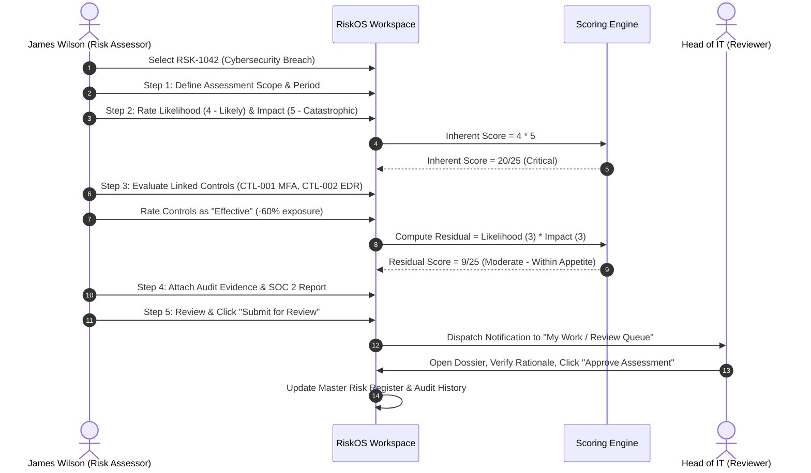
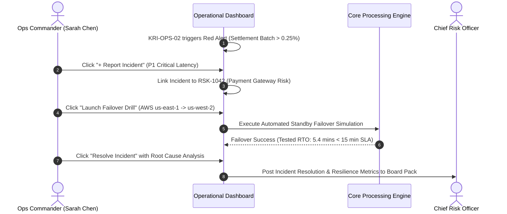
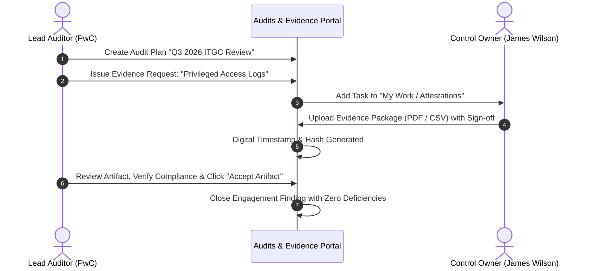
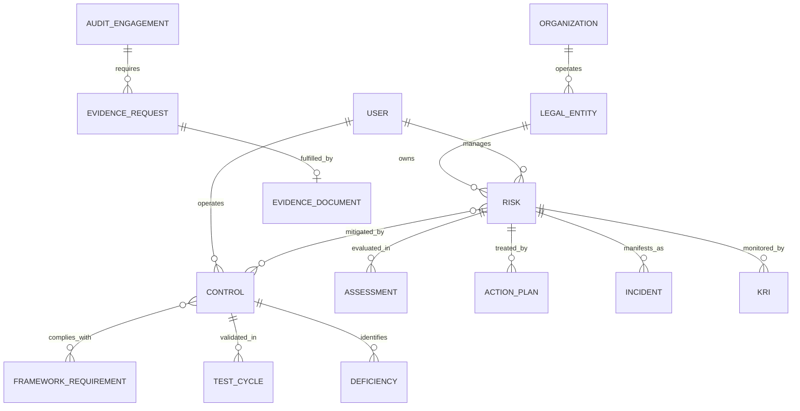

# RiskOS — Comprehensive Enterprise System Documentation
**Enterprise Risk Management (ERM) SaaS Platform Architecture, Design System, User Flows & Engineering Specification**

---

## 1. Executive Summary & System Vision

### 1.1 Platform Mission
**RiskOS** is a next-generation Enterprise Risk Management (ERM) SaaS platform engineered for financial institutions, highly regulated tech enterprises, and global organizations. RiskOS bridges executive risk governance with frontline operational realities, transforming static compliance checkboxes into an active, data-driven operational control system.

### 1.2 Regulatory & Industry Framework Alignment
RiskOS is natively modeled against the gold standards of international governance and enterprise resilience:
* **COSO Enterprise Risk Management (2017)**: Integrating with Strategy and Performance.
* **ISO 31000:2018**: Risk Management Principles and Guidelines.
* **ISO 27001:2022 & SOC 2 Type II**: Security, Availability, and Confidentiality Trust Services Criteria.
* **NIST Cybersecurity Framework (CSF 2.0)**: Govern, Identify, Protect, Detect, Respond, Recover.
* **Digital Operational Resilience Act (DORA)**: Stringent ICT operational risk, third-party vendor oversight, and mandatory recovery time objectives (RTO/RPO).
* **Basel III / BCBS 239**: Risk data aggregation and risk reporting standards.

### 1.3 Key Stakeholder Personas & Value Drivers

| Persona | Role | Core Objectives in RiskOS | Primary Workspaces |
| :--- | :--- | :--- | :--- |
| **Chief Risk Officer (CRO)** | Executive Risk Governance | Macro portfolio exposure, appetite breach monitoring, Board risk pack reporting, capital allocation. | `dashboard-executive`, `reports-board`, `org-appetite` |
| **Head of Operational Risk / VP IT** | Operational Resilience | Incident containment, RTO/RPO failover drill verification, infrastructure telemetry, KRI tracking. | `dashboard-operations`, `incidents`, `scenarios-kris` |
| **Risk Owner / Department Lead** | Line 1 Risk Mitigation | Documenting risks, executing remediation action plans, completing periodic risk reviews. | `my-work`, `risks-all`, `assess-RSK-1042` |
| **Control Owner / Compliance Manager** | Line 2 Internal Controls | Designing preventive/detective controls, testing operational effectiveness, managing deficiencies. | `controls-library`, `controls-testing`, `frameworks-iso27001` |
| **Head of Internal Audit** | Line 3 Independent Assurance | Maintaining audit universe, sampling operational controls, logging findings, verifying evidence packages. | `audits-plan`, `audits-evidence`, `issues` |

---

## 2. Design System & Style Guide

RiskOS employs an authoritative, high-density, low-fatigue design language inspired by modern developer and enterprise benchmarks (Linear, Stripe, Vanta, and Apple Human Interface Guidelines).

```
                      ┌────────────────────────────────────────┐
                      │          Visual Foundation             │
                      │  Clean · High-Density · Authoritative  │
                      └───────────────────┬────────────────────┘
                                          │
         ┌────────────────────────────────┼────────────────────────────────┐
         ▼                                ▼                                ▼
┌──────────────────┐            ┌──────────────────┐            ┌──────────────────┐
│   Typography     │            │  Semantic Colors │            │ Elevation & UI   │
│ Inter + Mono     │            │ 5-Band Severity  │            │ Crisp Borders    │
└──────────────────┘            └──────────────────┘            └──────────────────┘
```

### 2.1 Design Principles
1. **Clarity Over Clutter**: Generous whitespace, precise typography, and intentional visual hierarchy prevent cognitive overload when evaluating high-stakes financial and cyber risks.
2. **Context-Preserving Depth**: Drawers, collapsible sidebars, and progressive disclosure patterns allow users to inspect granular telemetry without navigating away from their mental context.
3. **Color as Data, Not Decoration**: Color is reserved strictly for status, risk severity bands, control effectiveness, and action urgency. Neutral backgrounds prevent visual fatigue.
4. **Instant Tactile Feedback**: Optimistic UI updates, animated progress indicators, and tactile micro-interactions provide confidence during audit-critical operations.

### 2.2 Typography System

The typography pairs **Inter** (humanist sans-serif for high legibility in UI copy) with **JetBrains Mono** (monospaced for codes, IDs, monetary amounts, and matrix coordinates).

| Token / Usage | Font Family | Size | Weight | Tracking | Example |
| :--- | :--- | :--- | :--- | :--- | :--- |
| **Display Header** | Inter | `24px` (`text-2xl`) | Bold (`700`) | `-0.025em` | Executive Risk Dashboard |
| **Section Header** | Inter | `16px` (`text-base`) | SemiBold (`600`) | `-0.015em` | Key Risk Indicators (KRIs) |
| **Card / Item Title**| Inter | `14px` (`text-sm`) | SemiBold (`600`) | `-0.01em` | Cybersecurity Breach |
| **Body Text** | Inter | `13px` (`text-xs`) | Regular (`400`) | Normal | "Critical technology and third-party..." |
| **Caption / Helper**| Inter | `11px` (`text-[11px]`) | Medium (`500`) | Normal | "Last assessed Sep 28, 2026" |
| **Identifier / ID** | JetBrains Mono | `12px` (`text-xs`) | SemiBold (`600`) | Normal | `RSK-1042`, `CTL-002`, `INC-2026-88` |
| **Metric Value** | JetBrains Mono | `24px` (`text-2xl`) | Bold (`700`) | `-0.02em` | `99.94%`, `$4.8M`, `14.2h` |
| **Score / Ratio** | JetBrains Mono | `11px` (`text-[11px]`) | Bold (`700`) | Normal | `16/25`, `22/25` |

### 2.3 Semantic Color System & Risk Severity Scale

RiskOS implements a standard **5×5 Risk Severity Scale** mapped to ISO 31000 and institutional banking standards:

```
Score: Likelihood (1–5) × Impact (1–5) = 1 to 25
```

| Severity Band | Score Range | Color Token | Foreground | Background | Border | Action Required |
| :--- | :--- | :--- | :--- | :--- | :--- | :--- |
| **Critical** | `17 – 25` | Rose | `text-rose-700` | `bg-rose-50` | `border-rose-200` | Immediate board escalation; mandatory daily containment |
| **High** | `10 – 16` | Amber | `text-amber-700` | `bg-amber-50` | `border-amber-200` | Executive mitigation plan within 14 calendar days |
| **Moderate** | `5 – 9` | Yellow / Amber | `text-amber-800` | `bg-amber-50/50`| `border-amber-100` | Department-level remediation; 30-day review cycle |
| **Low** | `1 – 4` | Emerald | `text-emerald-700`| `bg-emerald-50`| `border-emerald-200`| Accepted residual risk; periodic annual review |

#### Control Effectiveness Color Scale
* **Effective**: `bg-emerald-50 text-emerald-700 border-emerald-200` (Reduces score by 60–80%)
* **Partially Effective**: `bg-amber-50 text-amber-700 border-amber-200` (Reduces score by 30–50%)
* **Ineffective / Gap**: `bg-rose-50 text-rose-700 border-rose-200` (0% reduction; logged deficiency)

### 2.4 Surfaces, Elevation & Borders
* **Page Canvas**: `#F8FAFC` (`bg-slate-50/60`) — clean, low-glare canvas.
* **Surface Containers**: `#FFFFFF` (`bg-white`) with subtle border `border-slate-200/80` and `rounded-xl`.
* **Elevated Overlays / Modals**: `bg-white`, `border-slate-200`, `shadow-2xl`, with backdrop `bg-black/50 backdrop-blur-xs`.
* **Interactive Hover States**: `hover:border-slate-300 hover:shadow-xs transition-all duration-150`.

---

## 3. Component Architecture & UI Kit

```
src/
├── components/ui/               # Reusable atomic UI primitives
│   ├── avatar.tsx               # User initials and role rings
│   ├── badge.tsx                # Status, severity & tag badges
│   ├── breadcrumb.tsx           # Multi-level hierarchical path navigation
│   ├── button.tsx               # Primary, Secondary, Ghost, Danger button variants
│   ├── card.tsx                 # Base card container with headers & footers
│   ├── dialog.tsx               # Accessible modal overlay and container
│   ├── drawer.tsx               # Slide-over inspection drawer
│   ├── dropdown-menu.tsx        # Action dropdowns
│   ├── input.tsx                # Text and numeric input primitives
│   ├── search.tsx               # Global ⌘K search command palette
│   ├── select.tsx               # Styled native & custom select pickers
│   ├── sidebar-nav.tsx          # Collapsible tree sidebar navigation
│   └── tooltip.tsx              # Contextual hover tooltips
├── dashboard/                   # Executive Dashboard module
├── controls/                    # Control Library module
├── risk-register/               # Risk Register module
├── risk-details/                # In-depth Risk Dossier module
├── risk-assessment/             # 5-step Assessment Workspace module
├── risk-matrix/                 # 5×5 Interactive Heatmap module
└── modules/                     # Operational workspaces
    ├── actions-incidents/       # Action Plans, Incidents & Findings
    ├── assessments/             # Assessment Campaigns & Templates
    ├── audits/                  # Audits, Engagements & Evidence Upload
    ├── controls-ops/            # Control Testing, Cycles & Deficiencies
    ├── frameworks-policies/     # ISO 27001, SOC 2, NIST CSF, Custom
    ├── my-work/                 # Personal Action Queue & Attestations
    ├── operational-dashboard/   # Real-time Resilience, DORA RTO/RPO & Incidents
    ├── organization-admin/      # Org Tree, Taxonomy, Appetite Calibrator & Settings
    ├── reports-analytics/       # Board Deck Generator & Workflow Automations
    └── scenarios-kris/          # Stress Testing Simulator & KRI Telemetry
```

### 3.1 Primary UI Primitives

#### `Button` (`src/components/ui/button.tsx`)
* **Variants**: `primary` (slate-900 / blue-600), `secondary` (white / slate-200 border), `ghost`, `danger` (rose-600).
* **Sizes**: `sm` (h-7, text-xs), `md` (h-8.5, text-xs), `lg` (h-10, text-sm).
* **States**: Supports icons, active loading spinner, disabled state, and keyboard focus rings.

#### `Badge` (`src/components/ui/badge.tsx`)
* Supports status dots (`animate-pulse` for active alerts), monospaced coordinates, and semantic color pairings.

#### `GlobalSearch` (`src/components/ui/search.tsx`)
* Activated via `⌘K` or top-bar search input.
* Searches across Risks, Controls, and Team Members.
* Direct routing into target risk dossiers (`risk-RSK-1042`), control library, or profile.

#### `Matrix5x5` (`src/risk-matrix/components/HeatmapGrid5x5.tsx`)
* Full 5×5 SVG / CSS grid mapping Likelihood (Y-axis: 1 Rare to 5 Almost Certain) against Impact (X-axis: 1 Insignificant to 5 Catastrophic).
* Dynamic coordinate calculation: Score = $L \times I$.
* Supports coordinate drill-down filtering risks within each specific coordinate.

---

## 4. Information Architecture & Complete Route Map

The RiskOS navigation tree is organized into **7 top-level domains** containing **40+ fully implemented routes**:

```mermaid
graph TD
    AppShell["RiskOS Shell (AppShell.tsx)"]
    
    AppShell --> Overview["1. Overview"]
    Overview --> DashExec["dashboard-executive (Executive Overview)"]
    Overview --> DashOps["dashboard-operations (Operational Risk)"]
    Overview --> MyWork["my-work (Actions, Reviews, Attestations)"]

    AppShell --> RiskMgmt["2. Risk Management"]
    RiskMgmt --> RiskReg["risks (All, Category, Owner, Emerging)"]
    RiskMgmt --> Matrix["risks-heat-map (5x5 Heatmap Matrix)"]
    RiskMgmt --> Dossier["risk-RSK-1042 (Individual Dossier)"]
    RiskMgmt --> Assess["assess-RSK-1042 (5-Step Assessment)"]
    RiskMgmt --> Campaigns["assessments (Active, Templates, History)"]
    RiskMgmt --> Scenarios["scenarios (Library, KRIs, Breaches)"]

    AppShell --> ControlsEnv["3. Control Environment"]
    ControlsEnv --> CtlLib["controls-library (Control Library)"]
    ControlsEnv --> CtlOps["controls-testing (Testing, Deficiencies)"]
    ControlsEnv --> Frameworks["frameworks (ISO 27001, SOC 2, NIST, Custom)"]
    ControlsEnv --> Policies["policies (Governance & Standards)"]

    AppShell --> ResponseAssur["4. Response & Assurance"]
    ResponseAssur --> Actions["actions (Open, Overdue, Completed)"]
    ResponseAssur --> Incidents["incidents (Operational Incidents)"]
    ResponseAssur --> Issues["issues (Audit Findings)"]
    ResponseAssur --> Audits["audits (Plan, Engagements, Evidence)"]

    AppShell --> Insights["5. Insights"]
    Insights --> Reports["reports (Board Pack, RCSA, Regulatory)"]
    Insights --> Analytics["analytics (Concentration & Migration)"]
    Insights --> Workflows["workflow (Automated SLA Rules)"]

    AppShell --> OrgAdmin["6. Organization & Admin"]
    OrgAdmin --> Entities["org-entities (Legal Hierarchy)"]
    OrgAdmin --> Taxonomy["org-taxonomy (5-Level Taxonomy)"]
    OrgAdmin --> Appetite["org-appetite (Appetite Calibrator)"]
    OrgAdmin --> People["people (RACI Directory)"]
    OrgAdmin --> Integrations["integrations (AWS, Jira, Okta)"]
    OrgAdmin --> Settings["settings (General, Scoring, Security)"]
```



---

## 5. End-to-End User Flows & System Lifecycles

### Flow 1: Risk Assessment Lifecycle (RSK-1042 Journey)
From identification to residual risk sign-off:



### Flow 2: Operational Incident & Telemetry Failover
Continuous monitoring and DORA compliance:



### Flow 3: Internal Audit Engagement & Evidence Portal
Third-line defense evidence gathering:



---

## 6. Prototyping & Functional Capabilities Specification

Every workspace in RiskOS is interactive and data-driven:

### 6.1 Executive Dashboard (`ExecutiveDashboard.tsx`)
* **Live KPI Counters**: 248 Total Risks, 12 Critical, 38 High, $4.8M Residual Exposure (-8.2% vs previous quarter), 82% Control Effectiveness.
* **Interactive 5×5 Matrix Preview**: Hovering coordinates displays frequency; clicking coordinates drills down into filtered risk tables below.
* **Risk Detail Inspection Drawer**: Sliding right-hand drawer to inspect RSK-1042 without leaving the executive view.
* **Board Pack Generator Modal**: Customizable executive presentation generator with multi-select sections (Executive Summary, Top 10 Risks, Control Gaps, KRI Dashboard) and simulated PDF/PPTX export.

### 6.2 Operational Risk & Resilience Dashboard (`OperationalDashboard.tsx`)
* **Real-time Telemetry Bar**: Live segmented range selector (`24h`, `7d`, `30d`) with an interactive **"Sync Telemetry"** button that animates and updates stream health.
* **Incident Response Feed**: Live incident triage with instant **"Resolve Incident"** state updates.
* **Incident Creation Modal**: Form configuring title, P1–P4 severity, department, lead commander, and linked residual risk ID.
* **Business Continuity Drill Simulator**: Interactive **"Launch Failover Drill" Modal** executing automated chaos failover, recalculating tested RTO (5.4 mins) and verifying ISO 22301 / DORA SLAs.

### 6.3 My Work Workspace (`MyWorkWorkspace.tsx`)
* **Segmented Tabs**: Actions Due (4), Reviews Pending (2), Attestations (1).
* **Incremental Action Progress**: **"+20% Progress"** action increment button that automatically marks items as `Completed` upon reaching 100%.
* **Digital Attestation Sign-Off**: Interactive digital signature workflow recording date, user hash, and legal certification under SOX Section 404.

### 6.4 Risk Assessment Workspace (`RiskAssessmentWorkspace.tsx`)
* **Dedicated 5-Step Stepper**: Assessment Details → Likelihood & Impact → Control Effectiveness → Residual Risk → Review & Submit.
* **Dual Likelihood × Impact Matrix**: Configurable sliders recalculating inherent score (e.g. 4 × 5 = 20) and residual score (e.g. 3 × 3 = 9) in real time.
* **Control Rating Matrix**: Add/remove controls, configure preventive vs. detective efficacy, and visualize mitigated exposure reduction.

### 6.5 Scenarios & Stress Testing (`ScenariosKriWorkspace.tsx`)
* **Tail-Risk Stress Testing Runner**: Interactive modal featuring duration sliders (1–72 hours) and threat tier pickers computing financial loss ($M) and business disruption impact.
* **KRI Telemetry Dashboard**: Continuous monitoring of key risk indicators with amber warning and red breach status indicators.

### 6.6 Organization & Administration (`OrgAdminWorkspace.tsx`)
* **Risk Taxonomy Explorer**: Full 5-level hierarchical taxonomy (Financial, Operational, Technology, Regulatory, Strategic) with 19 operational branches.
* **Appetite Threshold Calibrator**: Interactive slider (4–20/25) that dynamically re-computes appetite breaches across all categories.
* **Settings Panels**: Real-time configuration for Workspace General, Scoring Models, Notifications, and Security & SSO.

---

## 7. Data Models & Entity Relationship Schema



### 7.1 Core TypeScript Interfaces

```typescript
// Core Risk Record
export interface RiskRecord {
  id: string                    // e.g. "RSK-1042"
  title: string                 // "Cybersecurity Breach"
  category: RiskCategory        // "Technology & Cyber" | "Operational" | ...
  department: string            // "IT Infrastructure"
  owner: string                 // "James Wilson"
  status: 'Draft' | 'Assessing' | 'Mitigating' | 'Accepted' | 'Archived'
  inherentLikelihood: number    // 1 to 5
  inherentImpact: number        // 1 to 5
  inherentScore: number         // 1 to 25
  residualLikelihood: number    // 1 to 5
  residualImpact: number        // 1 to 5
  residualScore: number         // 1 to 25
  appetiteStatus: 'Within Appetite' | 'At Appetite' | 'Above Appetite'
  lastAssessed: string          // ISO date or formatted string
  nextReview: string
  linkedControls: string[]      // ["CTL-001", "CTL-002"]
  openActionsCount: number
}

// Control Record
export interface ControlRecord {
  id: string                    // e.g. "CTL-002"
  name: string                  // "Endpoint Detection & Response (EDR)"
  type: 'Preventive' | 'Detective' | 'Corrective'
  category: string              // "Technical" | "Administrative" | "Physical"
  owner: string
  department: string
  implementationStatus: 'Implemented' | 'In Progress' | 'Planned'
  effectiveness: 'Effective' | 'Partially Effective' | 'Ineffective'
  frequency: 'Continuous' | 'Daily' | 'Monthly' | 'Quarterly' | 'Annual'
  linkedRisks: string[]         // ["RSK-1042"]
  frameworkMappings: string[]   // ["ISO 27001: A.12.2.1", "SOC 2: CC7.1"]
}

// Operational Incident
export interface IncidentRecord {
  id: string                    // e.g. "INC-2026-88"
  title: string
  severity: 'P1 · Critical' | 'P2 · High' | 'P3 · Moderate' | 'P4 · Low'
  status: 'Investigating' | 'Mitigating' | 'Resolved'
  department: string
  lead: string
  linkedRiskId: string          // "RSK-1042"
  startedAt: string
  resolvedAt?: string
  financialLoss?: string
}

// Key Risk Indicator (KRI)
export interface KRIRecord {
  id: string                    // e.g. "KRI-OPS-02"
  name: string
  category: string
  currentValue: string
  amberThreshold: string
  redThreshold: string
  status: 'Normal' | 'Warning' | 'Breached'
  trend: string
  acknowledged: boolean
}
```

---

## 8. Technology Stack & Production Build

### 8.1 Stack Architecture
* **Frontend Core**: React 19 + TypeScript (Strict typing with `noUnusedLocals` enabled).
* **Styling**: Tailwind CSS v4 with custom enterprise utility classes and design tokens.
* **Component Primitives**: Radix UI / custom headless primitives + class-variance-authority (`cva`).
* **Icons**: Lucide React (feather-style crisp line icons).
* **Build Tooling**: Vite v8.3 (instant HMR and optimized Rollup minification).
* **CI/CD & Deployment**: GitHub Actions workflow (`.github/workflows/deploy.yml`) building and publishing production artifacts to GitHub Pages.

### 8.2 Build Performance
```bash
# Production Build Command
npm run build (tsc -b && vite build)

# Verified Build Output:
✓ built in 209ms
dist/index.html                     0.86 kB
dist/assets/index-DxT5pquK.css    125.94 kB
dist/assets/index-ChjoYpY8.js   1,187.57 kB
```

---

## 9. Strategic Product Roadmap

```
2026 Q4 (Delivered)          2027 Q1                      2027 Q2                      2027 Q3-Q4
────────────────────         ────────────────────         ────────────────────         ────────────────────
• Design System & Shell      • Live API Integrations      • AI Copilot & Analysis      • Multi-Tenant Platform
• 40+ ERM Workspaces         • Continuous Controls (CCM)  • Monte Carlo Simulator      • SOC 2 Type II Certified
• 5x5 Matrix & Stepper       • Jira / ServiceNow Sync     • Predictive Drift Alerts    • FedRAMP High Baseline
```

### Phase 1: Foundation, Design System & Workspaces (Completed)
- [x] Foundation design system (Inter, JetBrains Mono, 5×5 severity bands, custom shadows).
- [x] Hierarchical navigation shell with collapsible submenus and `⌘K` global search.
- [x] Executive Dashboard, Operational Dashboard, and Personal Work Queue.
- [x] Risk Register, Risk Dossier, 5-step Risk Assessment, and 5×5 Heatmap.
- [x] Control Library, Testing Cycles, Deficiencies, Frameworks, and Policies.
- [x] Incident Triage, Internal Audit Plans, Evidence Upload Portal.
- [x] Scenario Stress Testing, KRIs, Board Pack Generator, and Appetite Calibrator.

### Phase 2: Live Integrations & Continuous Control Monitoring (Q1 2027)
- [ ] **Automated Telemetry Connectors**: Direct webhooks for AWS Security Hub, Datadog, Okta System Log, and GitHub Audit Log to automatically feed KRIs.
- [ ] **Bi-directional Ticketing Sync**: Jira and ServiceNow integration to synchronize action item remediation progress in real time.
- [ ] **Continuous Control Monitoring (CCM)**: Automated daily validation of technical controls (e.g., verifying 100% MFA enforcement via Okta API).

### Phase 3: AI Copilot & Quantitative Risk Analytics (Q2 2027)
- [ ] **RiskOS Copilot**: GenAI assistant for drafting risk descriptions, suggesting preventative controls based on industry incident databases, and identifying policy gaps.
- [ ] **Monte Carlo Quantitative Modeling**: FAIR (Factor Analysis of Information Risk) simulation engine computing Value-at-Risk (VaR) probability distributions.
- [ ] **Predictive Appetite Drift**: Machine learning models predicting likelihood of appetite threshold breaches 90 days in advance.

### Phase 4: Enterprise Scale & Regulatory Certifications (Q3–Q4 2027)
- [ ] **Multi-Tenant Enterprise Architecture**: Granular RBAC, row-level tenant isolation, and custom legal entity permission boundaries.
- [ ] **Formal Certifications**: Independent SOC 2 Type II audit report and ISO 27001:2022 external certification.
- [ ] **FedRAMP High / GovCloud Support**: Government-grade data sovereignty and hardware security module (HSM) key management.

---

*Document Version: 1.0.0 · Author: RiskOS Architecture & Design Systems Team · Status: Production Ready*

